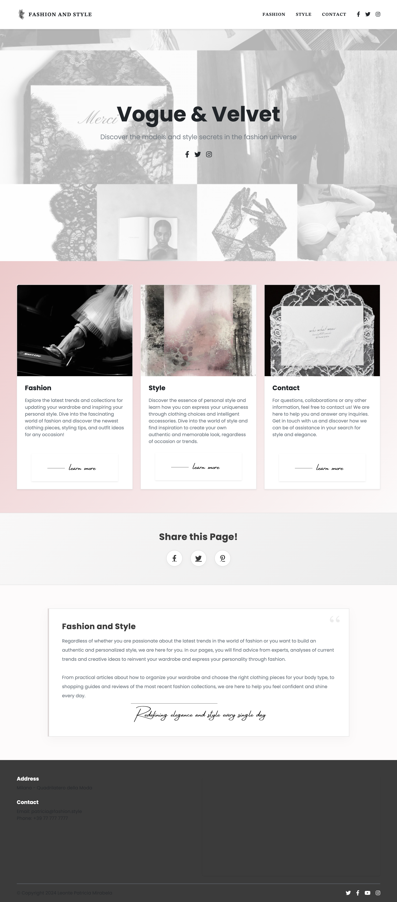
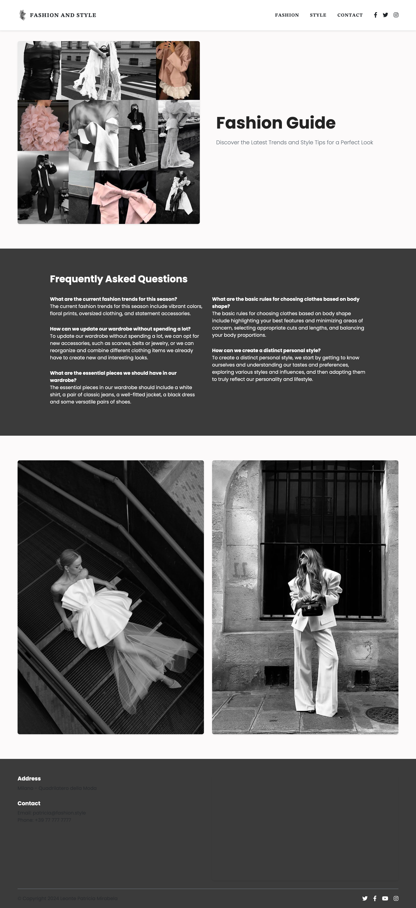
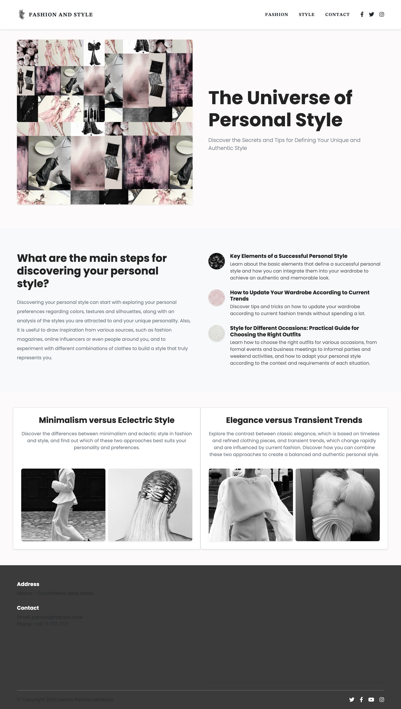
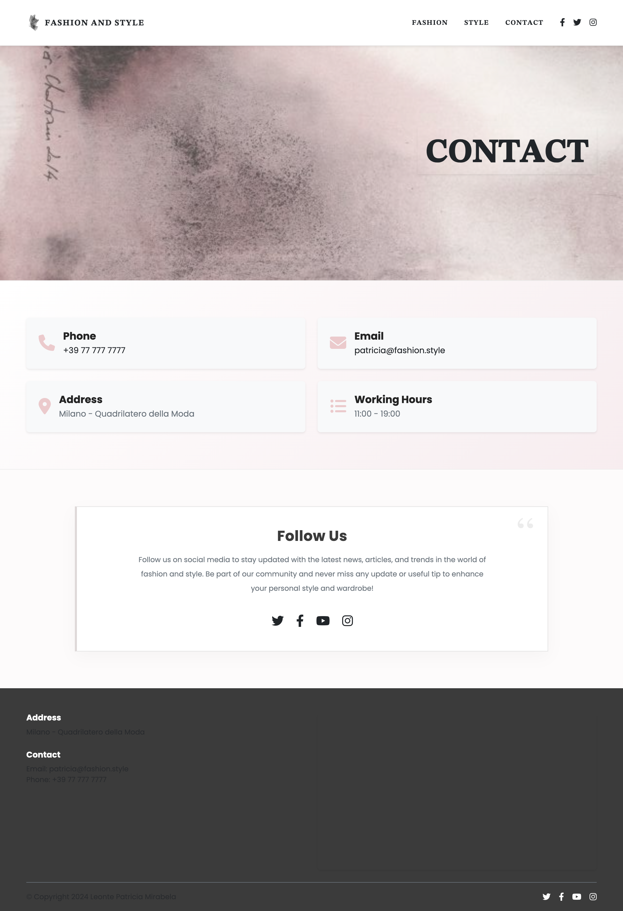

# Vogue & Velvet

## Overview
A sophisticated digital ecosystem dedicated to the fashion world, designed to harmonize sartorial passion with modern web technology. This platform serves as an immersive visual guide that explores current trends while empowering users to define their personal aesthetic through an intuitive and elegant interface.

---

## Tech Stack
- **Frontend:** HTML5, CSS3
- **Frameworks & Libs:** Bootstrap 5, Google Maps API
- **Social Integration:** FontAwesome Icons
- **Design:** Responsive Web Design (RWD)

  

 

---

## Core Functionality
- **Trend Forecasting:** Dedicated sections for seasonal highlights, featuring essential pieces like oversized silhouettes and vibrant color palettes.
- **Style Consulting:** Curated articles on minimalism vs. eclectic styles and fundamental fashion rules for wardrobe building.
- **Interactive FAQ:** A specialized module addressing common styling concerns and wardrobe management.
- **Advanced Components:** 
    - Google Maps integration for physical location mapping.
    - Validated contact forms for user inquiries.
    - Fluid navigation menus and seamless social media sharing.

---

## Project Structure
The project follows a modular architecture typical of modern static web applications:
- **Index / Home**: The central hub and general presentation of the platform.
- **Trends / Fashion**: Specific modules focused on industry news and visual inspiration.
- **Personal Style**: Educational resources for aesthetic development.
- **Assets**: Centralized organization for imagery, typography, and stylesheets (CSS).

  
  
  
  

---

© 2024 Vogue and Velvet | Developed by [**𝐋𝐞𝐨𝐧𝐭𝐞 𝐏𝐚𝐭𝐫𝐢𝐜𝐢𝐚-𝐌𝐢𝐫𝐚𝐛𝐞𝐥𝐚**](https://patrrrrrrricia.github.io/glowing-button/)
